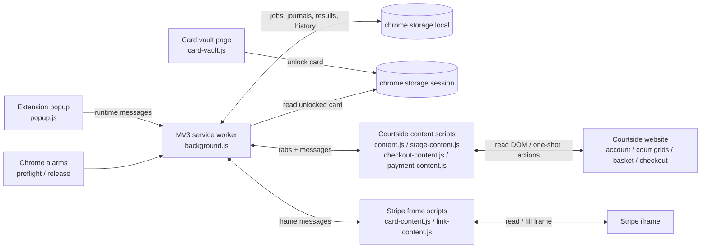
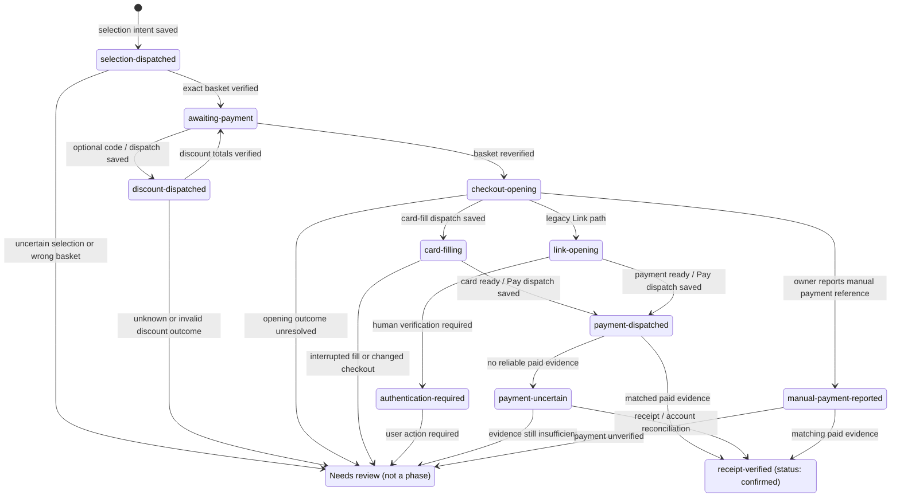

# Architecture and checkout lifecycle

**Scope:** The active Chrome Manifest V3 extension in [`outputs/tennis-local/chrome-extension/`](../outputs/tennis-local/chrome-extension/). The Python/Playwright prototype is retired. This is a **current implementation map**, not a proposal to redesign the system or a claim of unattended live acceptance.

The diagrams are intentionally conceptual: they show the main normal-booking path and consequential recovery boundaries, not every popup command, test-only phase, page retry or journal field. The source remains authoritative for guards and transitions.

## Components and ownership

- **Orchestration:** `background.js` owns alarm and popup admission, tab messaging, scheduling, work serialization and persistence of the overall result. `actions.js` serializes worker actions; `run-log.js` records sanitized traces. There is no separate deployed booking backend.
- **Selection and authorization:** `booking-settings.js` validates the saved preferences; `core.js` ranks candidates; `stage-rules.js` validates hour-by-hour slot and basket identity; `checkout.js` owns selection preparation and its journal. `grid-read.js`, `page-read.js` and `retry.js` bound read-side page observation.
- **Checkout and payment:** `discount.js` applies and verifies an optional discount, `payment.js` guards opening, card filling and Pay, and `reconciliation.js` checks trusted payment evidence. Content scripts interact with the merchant DOM; the worker does not treat a message acknowledgement as proof of a merchant mutation.
- **Card vault:** `card-vault.js` / `card-vault-core.js` read the owner-held encrypted card file and unlock it into trusted `chrome.storage.session`. The encrypted file stays outside the repository. Reloading/restarting the extension locks the session; the durable booking/payment journal remains.

## Scheduled booking flow

1. The popup saves an **immutable snapshot** of the chosen date, venues, hours, price caps and optional discount in a one-shot `job`. London midnight is seven days before the playing date; the preflight alarm runs five minutes earlier.
2. The service worker checks account/card readiness as applicable, reads court grids and chooses an authorized candidate. The scheduled path can retain the chosen grid tab temporarily for a fresh selection read; that tab handoff is not persisted as authorization.
3. `checkout.js` verifies the basket, **persists selection intent before dispatch**, selects the intended hour(s) sequentially, then checks the actual basket against the saved slot and gross price. A specifically authorized one-hour fallback can be adopted **only from observed intended basket contents**, without another selection click.
4. If a code was requested, `discount.js` journals its one-shot dispatch and verifies the basket gross/discount/net arithmetic before payment. The worker verifies the basket again before checkout opening.
5. `payment.js` journals opening and card-fill intent as relevant, verifies the provisional reference and payable amount, persists `paymentDispatchedAt` **before** a Pay click, then checks a matching receipt or account-purchase entry. Payment and active reservation status are distinct.

## Durable checkout lifecycle

The named nodes below (apart from **Needs review**) correspond to checkout record `phase` values. `status` is a separate field: a record is not `confirmed` until trusted paid evidence is matched. **Needs review** describes a stopped/held *outcome*, not a new persisted phase; the last journal phase and markers remain intact.

The normal scheduled **local-card** path is `selection-dispatched` → `awaiting-payment` → optional `discount-dispatched` → `checkout-opening` → `card-filling` → `payment-dispatched` → `receipt-verified`. The Link branch is an alternate legacy path, not the scheduled local-card route. A provisional reference may be renewed *before* Pay and its previous value retained. Basket-only/unpaid-checkout tests and explicitly attested abandonment have additional phases and guards; see the source and operating guide.

**Stop does not mean rollback.** A stopped run may keep `phase: selection-dispatched`, `discount-dispatched`, `checkout-opening`, `card-filling` or `payment-uncertain` with `recoveryRequired` or dispatch timestamps. Resuming a read is different from replaying a mutation. A missing acknowledgement never authorizes repeating selection, discount, checkout opening, card fill or Pay.

## State and restart boundaries

| Lifetime | Main data | Implication |
| --- | --- | --- |
| Persistent: `chrome.storage.local` | `job`, `bookingSettings`, `checkoutRecords`, `abandonedCheckouts`, `result`, `checkoutResult`, `runHistory`, `latestAction` (and temporary read-only `running` lock) | Unresolved mutation history survives worker restart and extension reload; an interrupted selection/payment is **not** safely replayable. |
| Session: `chrome.storage.session` | `localPaymentCard` after explicit unlock | Reload/browser restart requires a new unlock before a fresh payment attempt; receipt-only reconciliation does not require the card. |
| Invocation-only | `busy`, active trace, grid/basket tab handoff and content-script observations | A worker restart loses these hints. The worker must re-observe the site and consult durable journals rather than trusting previous DOM state. |
| External merchant | Basket, checkout reference, paid purchase and booking status | Merchant state is **not** transactional with Chrome storage; acknowledgement loss can leave the outcome unknown. |

### Recovery invariants

- Every consequential mutation has a durable intent/dispatch boundary. Never infer a failed mutation solely from a timeout, missing message response or closed tab.
- Verify the **saved slot, courts/hours, date, authorized cap and basket amounts** before checkout or Pay. Changing popup preferences does not rewrite an existing checkout authorization.
- `paymentDispatchedAt` or `manualPaymentReportedAt` makes the checkout **receipt/account-reconciliation-only**. Interrupted card filling also blocks automatic refill/Pay pending manual review.
- Read-only retry and recovery are narrowly bounded. Unrelated items, changed identity, missing evidence, a pending other checkout or uncertain site state preserve the hold.
- A matching paid purchase establishes **payment**, not necessarily an active booking or a refund. Keep payment, reservation, cancellation and refund evidence separate.

## Where details belong

- [Root README](../README.md): current product behavior, booking policy and development entry points.
- [Extension usage guide](../outputs/tennis-local/chrome-extension/README.md): setup, actual controls, recovery instructions and operational limitations.
- [Payment-system reference](payment-system.md): merchant DOM contracts, edge cases, recovery predicates and dated incidents.
- [Testing roadmap](test-improvement.md): regression architecture, scenarios and coverage/acceptance boundaries.
- [Release notes](release-notes.md): versioned changes and observed live acceptance evidence.
